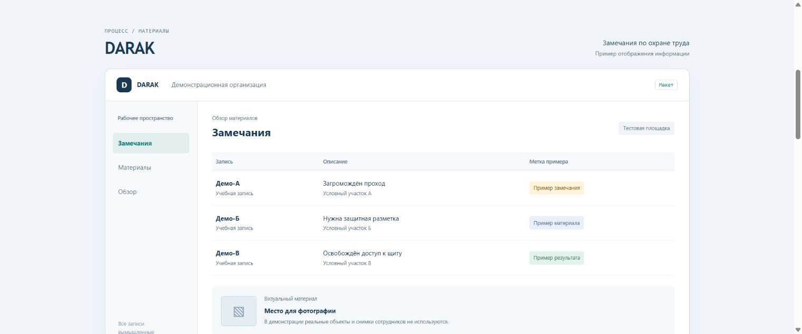
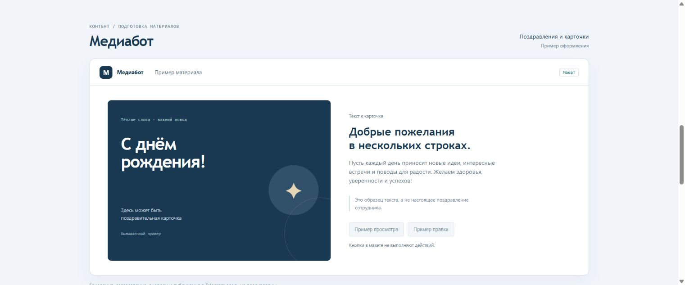
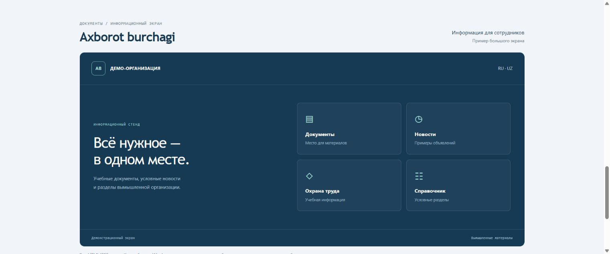

# Демонстрационные макеты

Три новых обезличенных статических экрана: DARAK, медиабот и информационный
стенд. Это вымышленные примеры оформления, не снимки рабочих систем.

## Посмотреть

Скачайте репозиторий и откройте `demo/index.html` в браузере. Для просмотра
через локальный сервер выполните из корня репозитория:

```sh
python -m http.server 8080
```

Откройте `http://localhost:8080/demo/`.

## Экраны

### DARAK

Вымышленные записи и условный материал в статической таблице.



### Медиабот

Пример карточки и поздравительного текста. Кнопки не выполняют действий.



### Информационный стенд

Условные документы, объявления и разделы вымышленной организации.



## Состав

Только HTML/CSS и снимки этих макетов. JavaScript, формы, внешние запросы,
API, серверы и внутренняя логика рабочих приложений отсутствуют.
